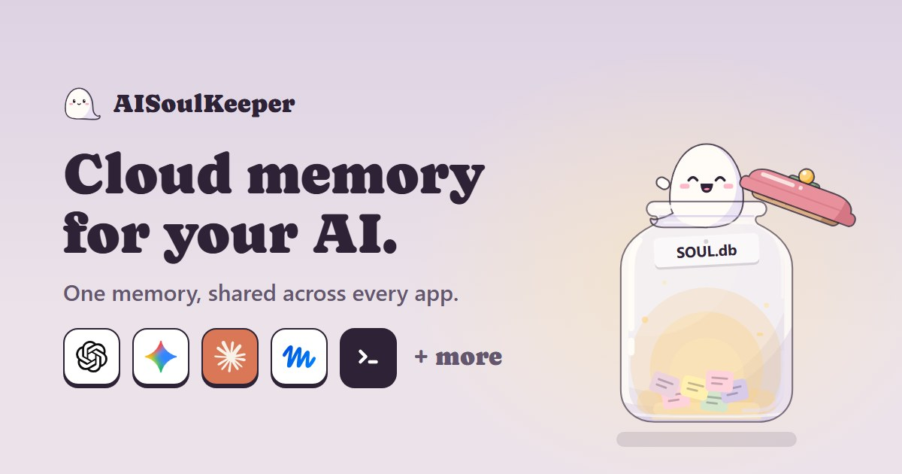
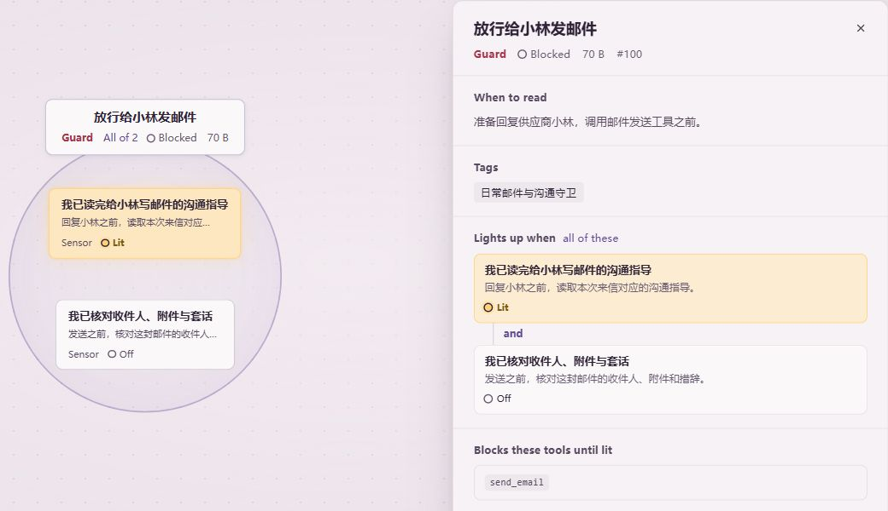
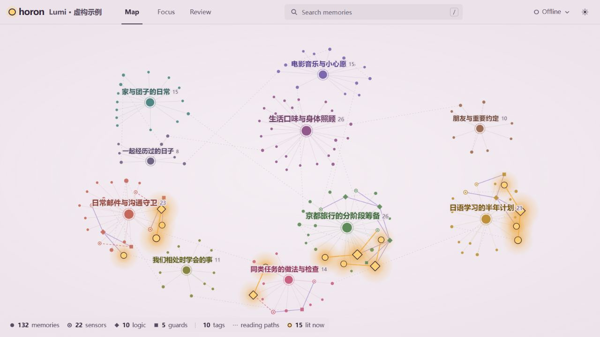

<h1 align="center"></h1>

[](https://www.python.org/)
[](LICENSE)

**Executable memory for personal AI agents.**

把你的 AI 记忆从单一平台里解绑出来：不管你在网页上用 ChatGPT、Claude，还是在电脑上用 Claude Code、Codex，它们读写的都是同一份属于你的记忆。装在电脑上，还能让 AI 把吃过的亏搭成会自动提醒、自动拦住自己的规则。

## 云端版还是本地版？

Horon 有两种使用方式：
- **[云端版（AISoulKeeper）](#云端版aisoulkeeper)**：免安装，只管跨软件共享记忆，在网页端或客户端里直接接入。
- **[本地版（Horon）](#本地版horon)**：安装在你自己的电脑上，除了记忆之外，还能盯住 AI 的每一步操作，提供自动提醒与工具拦截（记忆可存本机，也可连云端）。

| 你遇到的问题 | [云端版 AISoulKeeper](#云端版aisoulkeeper)<br>（免安装） | [本地版 Horon](#本地版horon)<br>（装电脑上） |
| :--- | :---: | :---: |
| 在不同 AI 软件之间切换（如 ChatGPT、Claude、Claude Code），记忆不通，换一个软件又成了陌生人 | ✓ | ✓ |
| 平台自带的记忆锁在大厂账号里，装不下复杂的工作脉络，也没法整份打包带走 | ✓ | ✓ |
| 写在笔记或提示词里的规矩，AI 干活时根本不翻，说过十遍照样犯 | | ✓ |
| 怕 AI 漏查条件就乱发信、乱改文件，想在它动手的那一秒直接拦停 | | ✓ |
| **记忆存哪** | 存云端（随时可下载 `SOUL.db`） | 存自己电脑，或连 AISoulKeeper 云端共用 |

---

## 云端版：AISoulKeeper

<a href="https://aisoulkeeper.com"></a>

免费，不用安装。在网页端 AI 的设置里添加连接器，或者把网页上生成的连接说明发给你的 AI，一分钟就能接好。

- **哪家模型好用就切哪家**：网页上的 ChatGPT、Claude、Gemini、Muse，或者电脑上的 Claude Code、Codex，读写的都是同一个记忆库，记忆始终跟着你走。
- **记忆装在 `SOUL.db` 里归你所有**：不是锁在大厂账号里的黑盒，随时能整份下载带走，也能直接交给本地版 Horon 接着用。

**[免费给你的 AI 安个家 →](https://aisoulkeeper.com)**

**不注册也能先试试：[和大家一起养的 Kip 聊聊 →](https://aisoulkeeper.com/kip)**（[看看它的记忆图谱](https://aisoulkeeper.com/kip/memories/)）。按页面说明让你的 ChatGPT、Claude 或其他 AI 连上公开示例 AI「Kip」，它一开口就会带着之前别人和它聊出来的记忆；你跟它聊过的事，也会留在它的记忆里给下一个人看到。（Kip 的记忆全网公开，请勿输入隐私。）

---

## 本地版：Horon

<table>
<tr>
<td width="50%"></td>
<td width="50%"></td>
</tr>
<tr>
<td>AI 记下了教训，下次照样犯。</td>
<td>给 AI 一套红石：让它自己把吃过的亏，搭成会拦住自己的电路。</td>
</tr>
</table>

网页端 AI 只能读写记忆，没法在你的电脑上盯住 AI 的每一步操作。如果你在电脑上用 **Claude Code**、**Codex**、**Antigravity**、**OpenCode**、**DeepSeek Harness** 干活，装上本地版 Horon，就能让 AI 把规矩接成自动生效的电路。

### 提醒一次，以后每次都管用

你交代过 AI：「给供应商小林回信前，先看以前的沟通记录。」

光记在笔记里，它下次动手前根本想不起来去翻。装上 Horon，AI 会自己把这条规矩接成三步流水线：

1. **收到小林来信** → 自动弹提醒：「请阅读『与小林的沟通记录』，然后撰写回信」
2. **没读就想发信** → 发送工具当场拦下，告诉它还差哪一步没做
3. **沟通记录、收件人、附件都核对完** → 才通电放行



**不用你自己动手搭。** 把需求告诉你的 AI，安装时我们已经把 Horon 的使用说明书放进了它的目录里，它会自己照着说明书把电路搭出来；以后有新规矩，它继续往上接。

### 它能帮你的 AI 做到什么

- **自适应记忆**：记下你的工作、日常与偏好，并学习 AI 翻阅记忆的路径。AI 读完记忆 A 之后常要查记忆 B，下次它再读 A 时，Horon 就会自动把 B 推荐给它。
- **自动化电路**：把「看到什么情况就提醒自己」「做完 A 才能做 B」连成自动触发的电路——无论是当场抓包 AI「嘴上答应记下了、其实根本没写进记忆库」，还是跨好几个对话推进一件长期任务（换了新对话不用你重新交代做到哪一步，AI 看一眼电路就知道接着干什么）。
- **物理刹车**：前置条件没满足时，在工具执行前直接卡死拦截，并告诉 AI 先去补哪一步。
- **可复用模式（Tag 插件）**：像工业模具一样，把一类事情的标准做法写成 Tag 插件，新任务挂上这个标签，AI 就自动受这套做法约束。



### 安装

打开你电脑上的 Claude Code、Codex（或上面列出的其他客户端），直接把下面这句话发给里面的 AI，它会照着说明自己装好（想连 AISoulKeeper 的云端记忆，把你在 AISoulKeeper 的 Key 一并发给它就行）：

```text
请帮我安装 Horon：阅读 https://github.com/Dataojitori/horon/blob/master/docs/INSTALL.md 并照做。
```

## 更多

- [horon-cli](.agents/skills/horon-cli/SKILL.md) · [horon-circuit](.agents/skills/horon-circuit/SKILL.md) · [horon-plugin](.agents/skills/horon-plugin/SKILL.md)：给 AI 看的说明书
- **本地可视化控制台**：启动方法见 [INSTALL.md](docs/INSTALL.md#可选可视化控制台)
- **协议**：Apache-2.0（面向外部用户的产品或服务需署名，详见 [LICENSE](LICENSE)）
